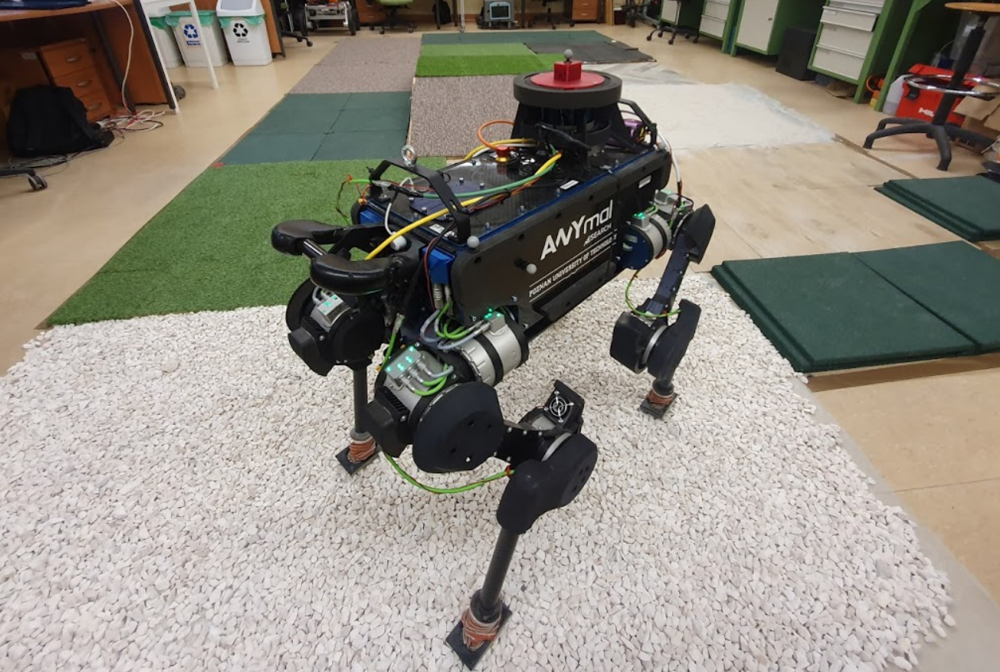
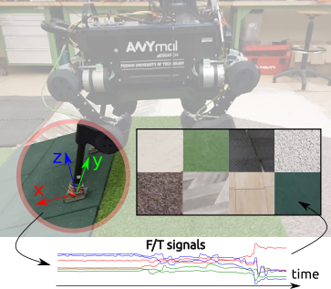
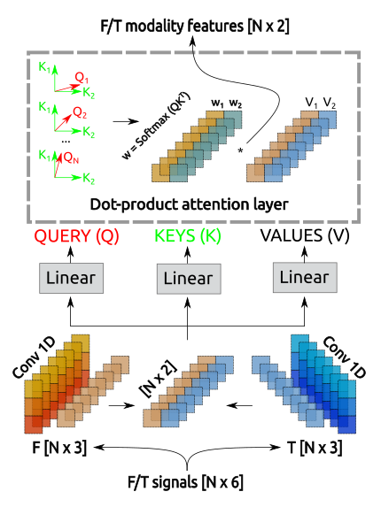
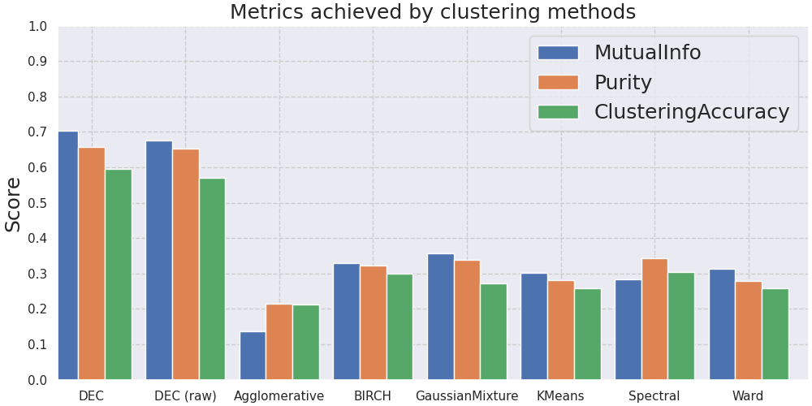

# Haptic Robotic Perception

**PhD Thesis**: *Combining interaction and perception to determine the physical properties of the robot environment*

Teaching robots to "feel" their environment through deep learning - material classification, stiffness estimation, and terrain recognition using force/torque sensors.

---

## Key Contributions

### [HAPTR - Transformer for Terrain Classification](https://ieeexplore.ieee.org/abstract/document/9568808/)
Developed the transformer architecture for terrain classification on legged robots. Achieved **30x parameter reduction** compared to CNN-RNN baselines while maintaining accuracy.

### [MAL - Modality Attention Layer](https://www.sciencedirect.com/science/article/abs/pii/S0921889022001373)
Designed a novel attention mechanism for fusing force/torque and IMU sensor data. Enables robust multi-modal perception for robotic manipulation.

### [DEC for Tactile Sensing](https://github.com/mbed92/haptic-unsupervised)
Adapted Deep Embedding Clustering to the tactile sensing domain for exploratory material analysis without labeled data.

---

## Future Research Directions

- **Foundation Models for Tactile Sensing** - Self-supervised learning for touch
- **Terrain Classification** - Cross-robot transfer, soft/deformable terrains
- **Multi-Modal Fusion** - Vision + touch integration

---

[*Michał Bednarek | PhD*](https://scholar.google.com/citations?user=X9W-9VAAAAAJ&hl=pl)
